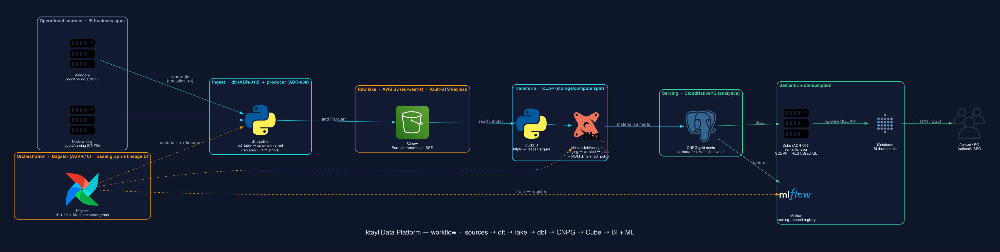

# ktayl-data-platform

Board **#5 (Data Platform)** — the **code** for the minicloud analytical data platform (dlt ingestion +
dbt transforms + Cube model + Dagster orchestration + Metabase provisioning). This is a **code repo**; it
is **deployed by `minicloud-gitops`** (`platform/data/data-platform/` — CNPG, ESO, netpols, lake CronJobs,
Cube, Dagster, Metabase, ArgoCD app), which git-clones this repo and runs the code. (App source here /
deployment config there — the platform's two-repo convention.)

> **Platform vs IS:** the data platform is a **minicloud (Platform) capability** — domain-agnostic. The
> insurer (**ktayl-solution IS**) is its *current consumer*; the engine is independent of the business.
> Full map: [central docs → Data Platform](https://andrelair-platform.github.io/minicloud-platform-docs/platform/data-layer/data-layer-overview).

Slice 1 = the **first thin vertical slice** per the [EA blueprint doctrine](https://andrelair-platform.github.io/minicloud-platform-docs/insurance-platform/enterprise-architecture-blueprint):
**one real live source → just-enough medallion → one data product → BI.** Deliberately *not* a generic
connector framework or an OLAP cluster for sources that don't exist yet.

> Two-layer model: this is the **ktayl-solution IS** (the insurer). Not Retrieva, not a certification deliverable.

## Architecture & workflow



*(diagram-as-code — `docs/diagrams/data_platform_workflow.py`, mingrammer `diagrams` + Graphviz)*

The end-to-end modern self-hosted stack (built across ADR-006..010):

| Stage | Tool | What |
|---|---|---|
| **Ingest** | **dlt** (ADR-010) + Vault-STS producer (ADR-008) | `sql_table` from the live source (ktayl-core `policy.policy`, underwriting) → schema-inferred load; replaces the hand-written COPY/DuckDB scripts |
| **Raw lake** | **AWS S3** (eu-west-1, ADR-008) | Parquet, versioned, SSE, keyless via the **Vault AWS secrets engine** (short-lived STS) |
| **Transform (OLAP)** | **DuckDB** + **dbt** (ADR-006/008) | DuckDB reads Parquet from S3 (httpfs) — storage/compute split; dbt builds `staging → curated → marts` + MDM dims (`dim_policy/customer/lob/period`) + `fact_policy` |
| **Serving store** | **CloudNativePG** (ADR-008) | gold marts in `analytics.business.* / lake.* / dlt_marts.*` — persistent, concurrent, HA + R2 PITR (the serving tier DuckDB materialises into) |
| **Semantic layer** | **Cube** (ADR-009) | governed metrics defined once; **Metabase consumes it natively via the pg-wire SQL API**; REST/GraphQL for apps/AI |
| **BI** | **Metabase** | dashboards over the semantic layer, Authentik SSO |
| **ML (MLOps)** | **scikit-learn + MLflow** (ADR-010) | MLflow = experiment tracking + model registry. Today a **demonstration** asset (`features→model→eval`) proves the loop — **not yet a production model**; first real use (need-first) = claims-fraud / policy-lapse scoring |
| **Orchestration** | **Dagster** (ADR-010) | dlt + dbt + ML as **one asset graph** with lineage, backfills, run observability |

> **Lakehouse — the "warehouse" is not one box:** **Data Lake** (S3, storage) + **DuckDB** (OLAP / lakehouse
> query *engine*) + **Serving Store** (CNPG, serving) **together = the data-warehouse capability**. DuckDB is
> the engine; CNPG is what it materialises into.

**Why these tools** (verified 2026 landscape): dlt = lightest code-native EL (a library, no standing infra); Dagster = asset-centric, best for dbt-heavy stacks, lighter than Airflow; Cube = the self-hostable semantic layer Metabase consumes natively (vs the dbt Semantic Layer, whose serving API is dbt-Cloud-bound). ML is covered by **Dagster assets + MLflow** — no Prefect needed. Decisions: `docs/architecture/adr/ADR-006..010`.

> **Deployment:** `minicloud-gitops/platform/data/data-platform/` (CNPG, ESO, netpols, lake producer + DuckDB/dbt CronJobs, Metabase, Cube, Dagster, ArgoCD app) git-clones this repo and runs the code.

## Layout

```
lake/           the S3-lake runtime (the LIVE path): producer/ (dlt → S3 Parquet, keyless Vault-STS),
                transform/ (DuckDB reads S3 → CNPG), dbt_duckdb/ (dbt over DuckDB), registry/ (dataset registry)
dbt/            dbt project(s) — dbt-postgres medallion (staging/marts) + see lake/dbt_duckdb
orchestration/  Dagster — ktayl_orchestration/ (dlt + dbt + ML asset graph), Dockerfile, workspace.yaml
semantic/       Cube semantic model (model/cubes/policy_portfolio.yml)
metabase/       provision_dashboard.py  (idempotent, secret-free dashboard provisioner)
ingest/         LEGACY direct-COPY scripts (ingest_policy.sh / ingest_underwriting.sh) — SUPERSEDED by
                lake/producer (dlt); kept for reference, their CronJobs were retired
```

## What Slice 1 delivers

```
ktayl-core · policy module (LIVE Postgres — the live policy source; formerly ktayl-policy-service,
             folded into ktayl-core)
        │  lake/producer (dlt → S3 Parquet; the legacy ingest_policy.sh COPY path is superseded)
        ▼
   raw.*              →  dbt staging (curated schema)  →  dbt marts (business schema)
   policies/coverages/   stg_policies / stg_premiums /     policy_portfolio  ◄── the data product
   premiums              stg_coverages
        ▼
   Metabase dashboard: Policy Portfolio (GWP proxy · TIV · counts by LOB/status/inception)
```

**Data product `policy_portfolio`** (grain = policy) — grounded on real source columns only:
- `gwp_eur` — **authoritative GWP** (Slice 2): `coalesce(underwriting rated premium, annualised proxy)`. *Seeds P2 (margin/portfolio).*
- `underwriting_premium_eur`, `rate_table_version`, `bound_via_underwriting` — the authoritative UW-origin columns (null for legacy/direct policies).
- `annualised_premium_eur` — GWP proxy, kept for lineage/comparison.
- `total_insured_amount_eur` — TIV. *Seeds P1/P3 (exposure/accumulation).*
- `scheduled_premium_eur`, `paid_premium_eur`, `coverage_count`, dims: `product_code`, `status`, `inception_year`.

## Slice 2 — underwriting as the authoritative GWP source (closes DP-007)

The **second real live pipeline** (need-first, not a generic connector framework). The underwriting
rating engine now emits real premiums (`quote.premium_minor`, eurocents) and links them to bound
policies (`binding.policy_number`), so the GWP proxy is promoted to the **authoritative rated premium**:

```
ktayl-underwriting (LIVE Postgres — 2nd real source: quote + binding)
        │  ingest/ingest_underwriting.sh  (full-refresh COPY, explicit column lists)
        ▼
   raw.uw_quotes / raw.uw_bindings  →  stg_uw_quotes / stg_uw_bindings (curated)
        ▼
   policy_portfolio (business): binding → quote by quote_id, keyed to the policy by policy_number
        → gwp_eur = coalesce(underwriting_premium_eur, annualised_premium_eur)
```

- **Join:** `binding.policy_number` = `policy_portfolio.policy_number`; premium via `binding.quote_id → quote.premium_minor`.
- **Authoritative for** underwriting-originated policies; **proxy fallback** for legacy/direct ones.
- The old proxy column (`annualised_premium_eur`) is kept, labelled, for lineage/comparison.

## Stack — current vs origin

The **current** stack is the [Architecture table above](#architecture--workflow) (dlt → S3 lake →
DuckDB/dbt → CNPG → Cube → Metabase + MLflow, Dagster-orchestrated). The platform **started** as a
light-first direct-COPY Postgres medallion (`ingest/*.sh` → `raw`/`curated`/`business` schemas +
dbt-postgres) — that Slice-1 path is **superseded** by the S3-lake runtime (ADR-008), though the
`business.policy_portfolio` **mart shape is preserved**. **ClickHouse/Trino were evaluated and NOT
adopted** — DuckDB over the S3 lake instead (sovereign, no standing OLAP cluster; see the central docs
*Alternatives considered*).

## Run locally

```bash
# LIVE path — the S3 lake:
python lake/producer/land_to_s3.py          # dlt: live source → S3 Parquet (needs Vault-STS env)
python lake/transform/transform_s3_to_cnpg.py   # DuckDB: S3 → CNPG; then dbt over lake/dbt_duckdb

# LEGACY direct-COPY path (superseded — kept for reference): env ANALYTICS_PG_* + POLICY_PG_* + UW_PG_*
sh ingest/ingest_policy.sh                   # land raw.policies/coverages/premiums
cd dbt && dbt deps && dbt build              # staging→marts + tests (build = run + test)
```

## Provision the Metabase dashboard (idempotent, secret-free)

```bash
# reads Vault secret/platform/data-platform for creds; safe to re-run / run on a fresh cluster
VAULT_TOKEN=... python3 metabase/provision_dashboard.py
```

## Run the pipeline in-cluster (on demand, not just the nightly cron)

The **live** path is the S3 lake (dlt → S3 → DuckDB/dbt → CNPG). The old direct-COPY CronJobs
(`dp-ingest-policy` / `dp-dbt-build`) were **retired**:

```bash
kubectl create job -n data-platform dp-land-manual      --from=cronjob/dp-lake-land-policy       # source → S3 Parquet (dlt)
kubectl create job -n data-platform dp-transform-manual --from=cronjob/dp-lake-transform-policy   # S3 → DuckDB/dbt → CNPG
kubectl exec -n data-platform dp-postgres-1 -- psql -U postgres -d analytics \
  -c "SELECT * FROM business.policy_portfolio;"                                                    # verify
# or run the full Dagster asset graph (dlt → dbt → ML) from the Dagster UI / webserver
```

## Metabase — one-time UI setup (SSO is a follow-up; internal Tailscale-gated for now)

URL: **https://metabase.10.0.0.200.nip.io** (needs Tailscale + the minicloud CA trusted). The pod runs
in `data-platform`; its own metadata DB is the `metabase` database on the `dp-postgres` CNPG cluster
(auto-created via the `Database` CR, creds from Vault `secret/platform/data-platform`).

1. **First visit** → create the admin account (Metabase's own login for now).
2. **Add the analytics database** as a data source:
   - Type **PostgreSQL** · Host `dp-postgres-rw.data-platform.svc.cluster.local` · Port `5432`
   - Database `analytics` · User `analytics` · Password = Vault `secret/platform/data-platform` → `analytics-password`
   - Schemas to expose: **`business`** (the serve layer; `curated`/`raw` are internal).
3. **Build the Policy Portfolio dashboard** over `business.policy_portfolio` (grain = policy):
   - GWP proxy = `sum(annualised_premium_eur)` · TIV = `sum(total_insured_amount_eur)`
   - policy count by `status` / `product_code` / `inception_year`
4. The seeded demo row `TEST-DP-SLICE1-001` (GWP €12,000 · TIV €1,000,000) is kept so the dashboard has data before real prod policies exist.

**TODO (hardening):** put Metabase behind Authentik SSO (forward-auth or Metabase OIDC) instead of its
local admin; re-add restricted egress via a CiliumNetworkPolicy (`toEntities: [kube-apiserver, world]`).

## Assumptions to confirm with the Policy domain (before treating metrics as authoritative)

1. **Minor units** — `amount`/`insured_amount` are BIGINT; assumed **cents** (÷100 → EUR). Confirm.
2. **Premium semantics** — are `premiums` rows **installments** (annualise = ×cadence) or a single annual figure? The GWP-proxy annualisation assumes installments; confirm before it's the official GWP.

## Next (Slice 1 → deployable → Slice 2)

- **Deploy (next PR):** `data-platform` namespace + quota · CNPG `analytics` cluster (+ AppProject sourceRepos/destination/namespaceResourceWhitelist + the cnpg ingress netpol — see [[feedback_cnpg_onboarding_gotchas]]) · ESO secrets (policy + analytics creds) · ingest + dbt CronJobs · Metabase Helm app · ArgoCD apps. Then verify raw→marts→dashboard live.
- **Slice 2:** add a second real source when the next domain ships; generalise the ingestion from 2–3 real pipelines (never a generic framework up-front). CDC over batch. Add MDM-keyed Customer 360 once MDM exists.
