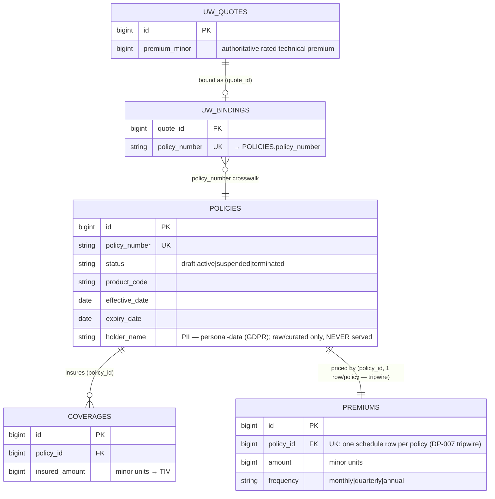
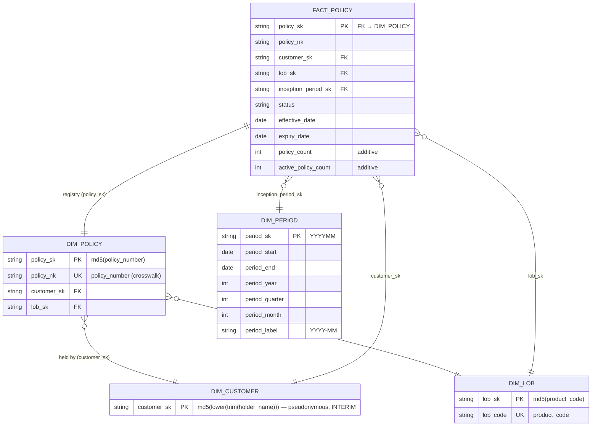

# Data model — ktayl-data-platform (ERD)

> **What this is.** The entity-relationship model of the data platform's *analytical* schema —
> the 1:1 **raw landing contract** and the conformed **serving star** (MDM dims + facts + the
> `policy_portfolio` data product). This is the SA "Data design" artefact (#7) and the human-readable
> companion to the dbt model contracts. Grain, keys, and PII classification are stated per entity.

## Why this is hand-authored, not `tbls`-generated

This repo's serving store is a **dbt-derived medallion warehouse**, not a migration-owned schema. Per the
platform `schema-erd` standard (the *dbt / warehouse carve-out*), a dbt warehouse is **not** gated by
`tbls` drift — its drift gate is the **committed dbt model contracts** (`models/**/_*.yml` + `tests:`) run
by **CI `dbt parse`**, plus the enforced `tests/assert_no_pii_in_serving.sql` gate. This ERD is therefore a
**documentation artefact** that mirrors those contracts; it is kept in sync by hand when the contracts
change (the contracts remain the machine-checked source of truth).

Schemas: `raw` (1:1 landing) → `curated` (dbt staging views, ephemeral — not shown as entities) →
`business` / `lake` (table-materialised serving marts).

---

## 1. Raw landing contract (`raw.*`)

1:1 copies of the live source tables (`ktayl-core` policy module + `ktayl-underwriting`). These are the
**only real columns that exist** — the data product is a contract over exactly these fields, enforced by
dbt source tests. `holder_name` is direct-identifier PII and is **blocked from the serving layer**.

---

## 2. Conformed serving star (`business.*` / `lake.*`)

Kimball-style star: a conformed-dimension spine (policy / customer / LOB / period) + `fact_policy`
(grain = one policy) + the `policy_portfolio` data product. **No PII** at this layer. Surrogate keys are
`md5(natural key)`; `dim_customer` is an **interim pseudonymous** dim (`md5(holder_name)`) until a real
Customer/CRM master ships (CAP-001 gap — see `dbt/models/marts/mdm/README.md`).

### Data products (served to Metabase / Cube)

| Model | Schema | Grain | Purpose |
|---|---|---|---|
| **`policy_portfolio`** | `business` | one policy | The data product: authoritative GWP (`coalesce(underwriting rated premium, annualised proxy)`), premium, TIV. Columns: `policy_id` PK, `policy_number` UK, `status`, `scheduled_premium_minor`, `annualised_premium_eur` (proxy), `underwriting_premium_eur` (authoritative, Slice 2), `rate_table_version`, `bound_via_underwriting`, `gwp_eur`, `gwp_minor` (not-null), `total_insured_amount_eur`. |
| **`policy_portfolio_lake`** | `lake` | `product_code × status × inception_year` | Pre-aggregated summary the DuckDB→CNPG lake path materialises for the Metabase dashboard + the Cube cube. Columns: `product_code`, `status`, `inception_year`, `policy_count`, `active_count`. |

---

## Entity summary

| Entity | Layer | Schema | Grain | PII | Keys |
|---|---|---|---|---|---|
| `policies` | raw | `raw` | one policy | **yes** (`holder_name`) | `id` PK · `policy_number` UK |
| `coverages` | raw | `raw` | one coverage | no | `id` PK · `policy_id` FK |
| `premiums` | raw | `raw` | one schedule/policy | no | `id` PK · `policy_id` FK+UK |
| `uw_quotes` | raw | `raw` | one quote | no | `id` PK |
| `uw_bindings` | raw | `raw` | one binding | no | `quote_id` FK · `policy_number` UK |
| `dim_policy` | serving | `business`/`lake` | one policy | no | `policy_sk` PK · `policy_nk` UK |
| `dim_customer` | serving | `business`/`lake` | one customer | no (pseudonymous) | `customer_sk` PK |
| `dim_lob` | serving | `business`/`lake` | one LOB | no | `lob_sk` PK · `lob_code` UK |
| `dim_period` | serving | `lake` | one calendar month | no | `period_sk` PK |
| `fact_policy` | serving | `lake` | one policy | no | `policy_sk` PK + conformed FKs |
| `policy_portfolio` | product | `business` | one policy | no | `policy_id` PK · `policy_number` UK |
| `policy_portfolio_lake` | product | `lake` | product×status×year | no | composite grain |

## Deliberately NOT modelled yet (source-blocked)

`dim_broker` and `dim_location` are **not built** — no authoritative source domain ships them yet
(ADR-007: don't build on stub data). A real Customer/CRM master replaces the interim `dim_customer`
when it exists. Premium/TIV measures on `fact_policy` (written/earned/UPR, exposure) are deferred to
`ktayl-core` Phase-1b (issue #28), when the premium + coverage tables land.

## Keeping this in sync

The dbt contracts are the machine-checked source of truth:
- `dbt/models/staging/_sources.yml` — the raw landing contract (+ source tests, the premium tripwire).
- `dbt/models/marts/_policy_portfolio.yml`, `dbt/models/marts/mdm/_mdm.yml` — the serving contracts.
- `lake/dbt_duckdb/models/marts/**/_*.yml` — the lake star contracts (fact/dim relationships tests).
- `tests/assert_no_pii_in_serving.sql` — enforces that no PII column reaches `business.*`.

CI (`dbt parse`) fails on any contract break. **When a contract changes, update this ERD in the same PR.**
